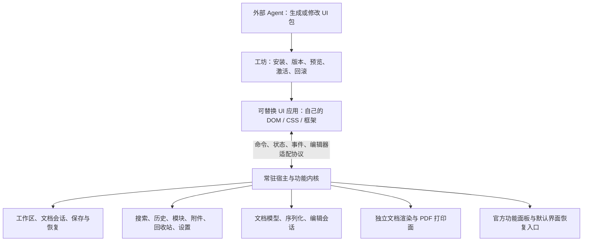

# UI 创意工坊与可替换前端设计

状态：架构提案，基于 v1.2.16。本文描述的完整 UI 包运行时、工坊与 headless Core **尚未实现**；当前已实现的是 [受约束外观包接口](custom-appearance-api.md)，不能将二者混称为已经完成的功能。

全面评估、源码与实验依据、运行域取舍、工作量及阶段门槛见 [可行性评估与技术路线](ui-workshop-feasibility.md)。实施决策优先参考该评估，其中补充了后端工作区一致性、Tauri 权限/进程限制和持续编辑面的实际边界。

## 产品目标

用户可以让外部 Agent 编写整套前端，再把它作为独立的 UI 应用包安装到 AstraNota。在工坊中一键预览、应用和回滚；软件继续管理同一套笔记与业务能力。

包可以自由采用 React、Vue、Svelte 或原生 HTML/CSS/JavaScript，重新设计布局、导航、列表、工具栏、设置、弹窗、路由和交互。不要求沿用官方 React 组件、CSS 类名、三栏结构或固定 slots。界面可以是传统桌面编辑器、紧凑 IDE、专注写作界面或卡片式知识工作台。

完整性承诺必须可检验：核心能力和文档规则由宿主维护；通过兼容验收的 UI 包具有完整功能；包遗漏入口时，宿主仍提供官方功能面板。允许第三方写任意 UI 代码，并不等于能自动证明每一份代码都正确。

## 工坊的用户体验

第一阶段采用本地工坊：内置官方包、导入包、管理已安装包。联网社区目录、账号、上传、作者发布和自动下载更新作为独立后续服务，不成为本地使用的前提。

| 页面或动作 | 行为 |
| --- | --- |
| 我的界面 | 展示已安装包的预览图、名称、作者、版本、兼容状态和当前激活标记 |
| 包详情 | 展示效果图、说明、功能覆盖、宿主/编辑器协议要求与更新说明 |
| 预览 | 在当前会话中查看候选包；有宿主控制的保留/取消入口，超时回原包 |
| 一键应用 | 完成兼容检查与内容交接后切换，不要求重启软件或重开工作区 |
| 回滚 | 恢复前一个 UI 包版本，保留当前文档内容 |
| 复制并改造 | 复制为新包，导出源码、SDK 契约和验收用例，交给外部 Agent 修改 |
| 从文件安装 | 导入离线构建包；用户机器无需 Node、npm 或编译工具 |
| 更新 UI 包 | 同一包安装新版本，预览确认后替换激活指针，旧版本保留 |
| 使用默认界面 | 宿主/原生菜单常驻入口，绕开自定义包返回官方界面 |

默认采用应用级激活设置；将来可增加“当前工作区覆盖默认界面”。不同 UI 包的布局偏好分别存储，切换包不改笔记路径和文档内容。

## 技术结构



宿主不随 UI 包卸载而销毁。保存、文档切换、工作区切换、历史恢复、上传完成等操作具有共同语义，所有前端都走同一条业务路径。

完整 UI 包属于独立的 `frontend` 类型；现有 JSON 外观包属于轻量 `theme` 类型。工坊可以统一管理这两类项目，但分别加载，不能把 JS bundle 填进当前 `appearanceV1` 字符串就宣称支持完整前端。

## 当前代码必须先解开的耦合

| 当前位置 | 耦合 | 迁移目标 |
| --- | --- | --- |
| `frontend/src/App.tsx` | 工作区、当前文章、标签、保存状态、恢复状态，以及切换前的保存/放弃保护都在组件闭包里 | 常驻 `AppSession`、工作区事务与文档会话服务 |
| `frontend/src/components/layout/EditorArea.tsx` | Tiptap、正文/源码保存、快照、请求序号、BOM/CRLF 保真、历史恢复与导出混在界面中 | `DocumentSession`、`SaveCoordinator`、编辑器与导出服务 |
| `frontend/src/state/shortcuts.ts` | handler 为 `() => void`，返回值仅说明找到入口；组件卸载就取消注册 | 参数化异步命令、执行结果、上下文可用性、取消与错误模型 |
| `frontend/src/components/layout/RightPanel.tsx` | 大纲依赖 `.ke-editor-prose` 和标题文本查 DOM | 稳定文档锚点与 editor adapter 的定位能力 |
| `frontend/src/components/common/PromptDialog.tsx` | 对话框 Promise 依赖 React setter 与宿主挂载 | 常驻 DialogBroker；可替换展示 provider，官方展示兜底 |
| `frontend/src/editor/index.ts` | 文档模型、序列化、React NodeView、DOM 事件、`useEditor` 耦合 | 文档内核、编辑会话与 renderer/adapter 分层 |
| `frontend/src/desktop.ts`、`desktop/src-tauri/src/lib.rs` | 关窗/重载 flush 握手依赖主前端上下文 | 宿主持有握手，UI 只能请求，不负责保证落盘 |
| `desktop/src-tauri/src/print.rs` | PDF 打印当前主 WebView，依赖当前前端 DOM | 独立可信文档渲染/打印上下文 |

只给现有 `runAction` 套一层全局 SDK 无法满足需求：卸载官方 UI 后，许多状态和 handler 也会消失。

## 通用协议应开放什么

以下名称和示例是拟议协议，不是当前可调用 API。

1. **能力发现**：命令目录、参数 schema、结果 schema、支持的文档节点、可用面板与编辑器协议。
2. **状态读取**：带版本的快照，以及增量事件订阅；断线重连可以重新同步。
3. **业务命令**：文档/工作区操作、编辑、保存、搜索、模块、附件、历史、恢复、回收站、设置和导出。
4. **编辑器适配**：打开会话、提交事务或源码修改、选区/锚点、撤销重做、焦点和输入法交接。
5. **展示意图**：请求显示搜索、历史或公式编辑等功能；自定义 UI 可以接管展示，未接管时由官方功能面板处理。
6. **包生命周期**：初始化、只读预览、准备切换、提交输入、序列化 UI 私有状态、激活、释放资源和健康握手。

状态协议区分 `acceptedRevision`（Core 已接收，可能仍在内存中）和 `durableRevision`（内容或恢复日志已可靠持久化）。存活会话可以保留前者，崩溃重启只能承诺恢复后者，不能将自动保存防抖期间的内存确认描述成已经落盘。

```ts
// 拟议示例；不等同于当前 window.astranotaAppearance。
const capabilities = await host.describe()
const snapshot = await host.getSnapshot()
const unsubscribe = host.subscribe({ after: snapshot.eventCursor }, onEvent)

const result = await host.execute({
  command: 'document.save',
  requestId: crypto.randomUUID(),
  sessionId: snapshot.activeDocument.sessionId,
  workspaceEpoch: snapshot.workspace.epoch,
  expectedRevision: snapshot.activeDocument.revision,
  args: {}
})
// result 明确区分 completed / cancelled / conflict / unavailable / failed。
```

宿主将每个通信连接绑定到对应包、会话和 UI 激活代次，校验参数及目标版本。旧 UI 的迟到消息不能在新工作区继续写入；重复请求不得导致双重创建、重复上传或重复恢复。命令的 Promise 必须报告操作的实际结果，不能将“按钮已点击”等同于保存成功。

已有快捷键和原生菜单成为同一命令服务的调用方，不再依赖某个按钮存在。纯展示动作（如搜索框聚焦）通过展示 provider 路由，所有业务写入由 Core 执行。

## “全部功能保留”的实现方式

建立完整功能目录，不能只使用当前快捷键动作表代替。每项功能需要声明输入、上下文可用性、执行方式与必要的官方展示入口。

宿主始终提供“全部功能”与“使用默认界面”。第三方 UI 可以重新组织所有入口；没有专门适配的新功能可以通过宿主功能目录打开官方面板。这样保证能力可达，但不会声称旧包能自动设计出新版功能的专属界面。

工坊的“完整兼容”标记由真实验收结果产生。包作者的 manifest 声明仅用于能力协商，不能代替功能测试。允许实验性包预览，但不将其标记为已经完整兼容。

验收至少覆盖 v1.2.16 的工作区创建/切换/关闭、文件与目录操作、标签与搜索、多文档标签、自动保存/手动保存、草稿与外部修改恢复、历史、附件/拖拽/上传、模块、信息块、脚注、表格、行内/块公式与公式编辑、微分 d 转换、正文/源码切换、KE/普通 Markdown/ZIP/PDF 导出、设置、快捷键与原生菜单。

## 编辑区域也允许自由重做

整套 UI 自由与编辑器渲染实现应分别验收，提供三条路线：

| 路线 | 能改什么 | 要求 |
| --- | --- | --- |
| 官方编辑面 + 任意外部 UI | 任意重做周边界面与交互，移动/调整编辑区域，工具栏完全重做 | 推荐首先支持；复用已有编辑能力 |
| 官方 editor runtime + 自定义 renderer | 使用官方文档 schema、解析、事务协议，重做编辑面呈现与扩展节点交互 | 需要新的 renderer SDK 和输入/选区/历史同步验收 |
| 第三方 editor adapter | 正文输入、布局、公式和表格等也可完全重写 | 通过保真、IME、撤销重做、未知节点、源码、并发和导出测试后才标记完整兼容 |

第三条路线必须保留打开官方编辑器的通道，不能把第三方暂未支持的节点静默转成普通文字或丢弃。遇到超出 adapter 能力的内容，应保留原始内容并提供明确的官方打开入口。

跨 iframe 不能传递 DOM 元素或 Tiptap Editor 对象，因此 `mountEditor(element)` 不能当成跨运行域的万能实现。官方编辑面需要独立运行域和布局定位协议；另一条路线是向包提供与宿主协议匹配的编辑 runtime，由宿主管理权威文档、版本与保存。两条路线都需要真实输入法、焦点、剪贴板、拖拽和选区验证。

## 一键切换的内部流程

用户只点击一次，宿主完成完整交接：

1. 校验候选包与协议，准备资源，使用只读快照初始化候选 UI；此时旧 UI 仍可正常使用。
2. 候选 UI 完成必要的初始化和首屏握手。失败时保持旧界面，不修改激活配置。
3. 在有界切换屏障中等待输入法组词正常结束，再暂停旧 UI 新增输入和业务命令，只允许完成已有输入的交接。收集尚未提交的输入，交给 Core，并等待目标 `durableRevision`。未决对话框交给宿主继续处理或明确取消；Core 已接收的上传等任务绑定原文档会话继续执行，不依赖旧 UI 闭包。超时或保存失败则中止切换，恢复旧界面，不能强行结束组词或丢弃输入。
4. 取得带 revision/eventCursor 的最终快照，候选 UI 确认已经同步后，再撤销旧 UI 的写入资格，原子更新激活包、对应私有状态指针和 UI 代次；随后只给新 UI 写入资格，旧消息失效。握手失败时不提交激活，旧 UI 恢复使用。
5. 工作区、标签、已确认文档内容、保存队列与编辑会话由 Core 保留；选区和撤销历史通过具备对应能力的 adapter 交接，不能假定任何第三方编辑器天然支持无损迁移。
6. 候选包异常时切回上一包或官方 UI；恢复的是界面，不回滚已保存的笔记内容。

预览使用同一交接机制与可撤销激活指针，宿主提供独立确认控件。只读预览模式不允许候选 UI 写入；进入可编辑预览后，正常编辑仍通过 Core 保存。取消预览只恢复界面，预览期间已确认的文档编辑继续保留。

核心只能管理已收到的编辑事务；异常重启的内容保证以持久化确认或恢复日志为界。若第三方输入组件从未向 Core 提交某段输入，就不能承诺在该组件异常消失后凭空恢复它；adapter 必须定义输入确认、暂存与交接行为。

## UI 包与版本存储

包包含：manifest、预编译前端与静态资源、预览图、源码及锁文件、构建说明、兼容测试声明与校验信息。源码用于交给 Agent 改造；应用加载构建产物，不自动执行包内安装/构建脚本。

建议存储：

```text
%APPDATA%\KnowledgeEditor\ui-packs\
  <package-id>\<version>\
    manifest.json
    dist\
    source\
    previews\
  registry.json          # installed / staged / active / previous
  state\<package-id>\<state-schema>\<snapshot-id>\
                        # 仅界面私有布局和偏好；保留可回滚快照
```

文档内容继续留在用户工作区，不搬进 UI 包目录。已有外观设置与 UI 私有布局按不同命名空间保存。新版私有状态迁移使用副本，不覆盖旧版快照；激活时共同原子提交包与私有状态指针，回滚旧包时恢复对应状态版本。注册表用原子替换，安装不完整时不改激活指针，保留内置官方 UI。

## 软件与工坊更新

分别管理应用/Core 版本、UI 协议版本、文档/编辑 adapter 协议版本、UI 包自身版本。

| 更新情形 | 处理 |
| --- | --- |
| 官方修复内核 bug，协议兼容 | 原 UI 包继续运行，复用修复后的能力 |
| 官方新增功能 | 命令与面板加入宿主目录；旧 UI 通过“全部功能”可访问 |
| UI 作者发布新布局 | 安装新包版本，预览后切换，保留旧包 |
| UI 协议增加可选能力 | 协商支持范围，旧包保持原行为 |
| 协议发生破坏性变更 | 提供兼容适配期；无法适配时回官方 UI 并保留旧包 |
| Agent 升级私人 UI | 复制为候选新版本，读取机器可读迁移差异，构建与验收后再激活 |
| 应用降级 | 检查包和数据协议；不兼容包停用，保留其资源和私有状态 |

软件更新不覆盖用户的前端源码，不静默把用户定制包改成新代码。回滚 UI 与回滚 Core 是不同操作；UI 包不能自行执行文档格式迁移。

## 运行方式与桌面约束

候选方案是将 UI 包放入独立来源的 sandbox iframe，通过 MessagePort 通信，宿主代理所需业务 API。任意 CSS 只作用于包自身 DOM；Tauri 与原生保存握手由宿主持有。

当前 Tauri 的 CSP、asset scope 与主窗口资源策略不具备这套加载能力，需要设计独立的包资源加载器与 WebView 配置。当前后端没有认证 token，写请求主要依赖 Origin 校验；不能为实现插件而直接对所有包开放后端写来源，绕过 Core 保存与会话规则。

iframe 不能自动保证 CPU 或进程隔离。原生恢复入口和启动失败标记应独立于包的 JavaScript；如果要承诺包死循环时仍可切换，需要验证独立 WebView/进程的实际行为和宿主恢复路径。

桌面恢复应由 Rust 先持久化默认包/安全模式选择，再重建或重载对应 WebView，不能只给可能冻结的 JS 发事件。加载候选包前写入 `bootPending`；`ready` 只代表握手，健康标记由宿主按明确条件推进，连续失败时绕过候选包。

PDF 应基于 Core 指定 revision 的当前会话/草稿只读快照，在独立渲染/打印上下文生成，不能只读最后磁盘版本。导出不隐式保存或改写工作区，保留 v1.2.16 导出当前未保存内容的能力。默认使用官方文档 renderer、字体和公式支持，UI 包的任意 DOM 与 CSS 不参与默认 PDF。

任意第三方编辑面可以具有不同的呈现，因此不能同时承诺其任意 CSS 与默认 PDF 逐像素相同。若需要定制文档排版并保持所见即所得，应另建文档呈现协议，让屏幕与 PDF 共用经过验收的 renderer 和排版配置。

## 实施阶段与完成标准

| 阶段 | 交付 | 完成标准 |
| --- | --- | --- |
| 1：功能契约冻结 | v1.2.16 功能清单、行为不变量、真实文档样本与回归矩阵 | 所有现有功能均有归属，特别覆盖竞态、恢复与保真用例 |
| 2：抽离 Core | AppSession、DocumentSession、保存协调、命令/状态/事件服务 | 官方前端改用 Core；卸载官方 App/EditorArea 后，无 DOM 的 Core/协议测试仍能保存、切换工作区、恢复并正确处理晚到请求 |
| 3：完整前端运行时 | 包安装/加载、通信、生命周期、官方恢复入口、独立打印 | 第二套前端可独立启动，无法通过复用隐藏的官方 App 假装完整解耦 |
| 4：本地创意工坊 | 已安装列表、详情、导入导出、复制、预览、应用、回滚 | 有两套结构明显不同的 UI；切换失败不丢已确认编辑，功能回归通过 |
| 5：编辑 adapter 与社区 | 自定义编辑面协议与验收，联网目录/作者发布 | 声明的自由度与实际能力一致；社区服务可用性不影响本地使用 |

推荐把“官方三栏界面”和“一套导航、布局、工具组织完全不同的界面”作为首批正式包，同时跑相同功能用例。这才证明系统可更换前端，而非只证明 CSS 可以覆盖颜色。
