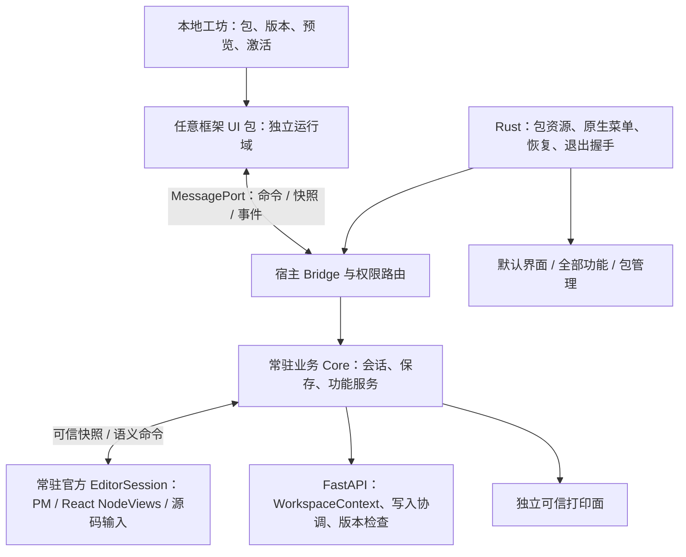

# UI 创意工坊：全面可行性评估与技术路线

评估日期：2026-10-17。代码基线：v1.2.16，提交 `9dd19e74d2e1d77c1c9cf7a98693a447dc10d148`，包含本会话上一阶段的轻量外观包改动。本文是工程评估和推荐路线，完整工坊尚未实现。

## 1. 决策结论

**可以建设“外部 Agent 编写独立前端、用户安装后从工坊切换”的平台。建议立项，但必须先验证编辑面和 Windows 运行域，再承诺正式范围与排期。**

首个可公开分发版本推荐：Windows 优先、本地工坊、任意框架的完整周边界面、常驻官方编辑面、统一业务 Core、离线预编译 UI 包、预览/应用/回滚、官方恢复入口。社区服务与完全替换正文编辑器分别建设。

三个承诺必须分开：

| 承诺 | 可行性 | 成立条件 |
| --- | --- | --- |
| 自由设计导航、布局、工具栏、列表、设置、业务面板与交互 | 高 | 包拥有自己的 DOM/CSS/框架，通过版本化协议使用 Core |
| 同一官方编辑面下换 UI，保留编辑内容及现有编辑能力 | 中高 | 编辑会话和输入 DOM 持续存在，保存/恢复迁出 UI，真机验收通过 |
| 自己重写正文编辑器及所有特殊节点交互 | 可开放，成本高 | 对具体 adapter 和版本进行格式、输入、历史与导出认证 |
| 任意第三方代码无需验收就完整继承全部功能 | 不成立 | 运行与声明兼容不等于行为正确 |
| 任意编辑器之间无损迁移撤销栈、选区和输入法组词 | 无通用保证 | 需要共同事务模型或专用转换，内容迁移不等于编辑状态迁移 |
| 任意文档 CSS 与官方 PDF 永远逐像素一致 | 不成立 | 需要单独的文档呈现协议，屏幕/打印复用 renderer 与排版配置 |

“一键”是用户操作数量，内部仍需要完整的事务交接；不能解释为无等待、无保存失败或永远即时完成。

## 2. 本轮评估做了什么

- 分别审计业务 Core、编辑器/PDF、桌面运行与权限、工坊/更新/交付，交叉核对前一版 [产品设计](ui-workshop-design.md)。
- 读取当前依赖与实现：React 19、Tiptap 3、FastAPI、Tauri 2；`Cargo.lock` 实际锁定 Tauri **2.11.5**，Wry **0.55.1**。
- 核对 Tauri 锁定版本源码和 WebView2 官方进程模型，纠正“子 WebView 可直接使用”“新 WebView 等于新进程”“不授 capability 就能阻止所有应用命令”的假设。
- 对现有后端做临时目录中的确定性调度实验，验证工作区上下文和迟到请求的边界。

证据等级：**源码确认**、**本轮实验确认**、**既有验证记录**、**待原型验证**。本文不把静态推断写成 Windows 实机结果。

上一阶段轻量外观包有 1590 项前端测试、构建和浏览器验证记录；这些证明该改动的回归状态，**不证明完整 UI 包、跨域编辑、包死循环恢复或工坊切换已可用**。当前测试主要为 happy-dom，尚无内建完整跨 UI 的 Playwright/Windows 验收流水线。后端已有 3 项 Linux 超长文件名失败，需要基线归属，不能重构时悄悄忽略。旧发布清单的部分记录和产品约束已过时，不能直接当 v1.2.16 功能清单。

## 3. 现有资产与主要缺口

### 3.1 可复用资产

无需重写整个项目。FastAPI 的文件访问、路径约束、历史、回收站、索引、附件和导入导出服务，以及 KE Markdown 的 parser/serializer、frontmatter、BOM/CRLF、未知节点保真、公式与表格算法，均有复用价值。

`state/saveQueue.ts`、`docSwitch.ts`、`draftDebounce.ts`、`requestSeq.ts` 已处理保存串行、旧请求、切档快照和持续输入的恢复登记。这些规则应搬入常驻服务并强化身份，不能在新 SDK 中另写一套简化版本。

现有 React/Tiptap/KaTeX/MathLive renderer 与 Windows 打印链同样应保留并重组，首版无需更换编辑引擎、Markdown 格式、后端语言或桌面框架。

### 3.2 决定工程量的耦合

| 代码证据（当前工作区） | 发现 | 影响 |
| --- | --- | --- |
| `frontend/src/App.tsx:73`，约 1182 行 | 工作区、文档、标签、保存/恢复状态及切换保护在组件闭包里 | 卸载官方 App 会失去业务会话 |
| `frontend/src/components/layout/EditorArea.tsx:125`，约 1778 行 | 编辑器、正文/源码保存、恢复、上传与导出混合 | 换组件不能直接等同于换皮肤 |
| `frontend/src/state/shortcuts.ts:620`、`:672` | handler 是 `() => void`，结果只表示找到入口；当前约 33 项动作 | 不能充当覆盖全部功能且报告实际成败的 SDK |
| `frontend/src/editor/index.ts:149`、`:351` | React hook 创建编辑器；`setKeContent` 清撤销历史 | 重新加载 Markdown/JSON 不等于保留同一编辑会话 |
| `frontend/src/components/editor/ExportPdfDialog.tsx:230` | 优先克隆实时 DOM；`getHTML()` 中没有 NodeView 的完整公式渲染 | 独立 PDF 需要真实 renderer，不能只搬一段 HTML |
| `desktop/src-tauri/src/print.rs:86` | 打印主 WebView `main` | 外部 UI 任意改 DOM 后原打印前提不成立 |
| `backend/app/routers/documents.py:29`、`:269` | 更新无 workspace 身份与版本前置条件，多次读取全局状态 | 外部多调用方与热切换需要服务端一致性强化 |
| `backend/app/routers/workspace.py:72` | 切换全局 root/store/indexer/history/watcher | 前端取消请求不能保证后端已接收写入被撤销 |
| `desktop/src-tauri/capabilities/default.json` | 权限按 `windows=[main]` 授予 | 增加同窗口 guest 需要重新设计精确权限边界 |

大纲按 `.ke-editor-prose` 和标题文本定位、公式节点通过 window 事件请求弹窗、对话框 Promise 依赖 React setter，也都应改为能力接口。标题、tags、公式弹窗中的未提交草稿必须参与 UI 切换，不能只 flush 正文。

### 3.3 本轮实际边界实验

复现实验：[ui-workshop-context-probe.py](experiments/ui-workshop-context-probe.py)，结果：[JSON](experiments/ui-workshop-context-probe-result.json)。从仓库根执行：

```bash
backend/.venv/bin/python docs/experiments/ui-workshop-context-probe.py
```

实验只写临时目录，构造两套相同相对路径文档，并在文章更新已确定路径后模拟工作区状态替换。结果：

1. 正文写入工作区 A，但随后的索引更新使用工作区 B 的 indexer。
2. 旧请求在切换之后执行时，现有 API 无法携带并检查原工作区身份，会作用于当前工作区 B。

这是可控制调度下的**后端边界确认**，不是声称已经通过当前官方 UI 复现数据污染，也不是并发压力测试。它说明后端上下文绑定必须进入技术路线，不能仅靠 UI 层的 epoch 和 AbortController。

`atomic_write` 已有 fsync + replace，可防止半写文件；它不是版本比较，也不是防止覆盖外部程序修改的原子 CAS。应用内部锁与外部编辑器并发须分别处理。

## 4. 推荐架构与具体选型



### 4.1 常驻业务 Core 与可信编辑会话分开

业务 Core 使用 TypeScript 服务与可注入平台接口，保持无 React/DOM 依赖；第一期不为抽象纯粹性改成 Rust/Python 编辑内核。可信 `EditorSession` 可以有 DOM，持有真正的 ProseMirror state/view/history、React NodeView 根、源码 textarea 和输入法状态。

Core 管理已接收版本、保存、恢复、文档身份与功能服务；EditorSession 提供带 revision 的可信快照与语义命令。dirty 事件不等于 Core 已取得该版全文，保存时必须取得并核对目标 revision 的快照，再交给持久化链；取得后保存无需访问 DOM。收集尚在输入组件中的内容则需要输入参与者握手。UI 包不能直接 PUT 全文绕过会话管理。

建议模块：

```text
packages/document-codec/       # KE schema、原文特征、纯转换与 fixtures
packages/ui-protocol/          # JSON schema、类型、版本、错误与能力描述
frontend/src/core/             # AppSession、DocumentSession、SaveCoordinator
                              # WorkspaceCoordinator、StateStore、CommandService
                              # DialogBroker、各业务服务
frontend/src/editor-runtime/   # 常驻官方 EditorSession、NodeViews、输入/焦点
frontend/src/host/             # Bridge、恢复入口、官方功能面板、打印
frontend/src/official-ui/       # 官方前端，作为第一个 SDK 客户端
frontend/src/workshop/         # 工坊列表、详情与包操作
desktop/src-tauri/src/ui_packs/ # 安装、资源协议、注册表与原生恢复
tools/ui-pack/                 # Agent SDK/CLI 的开发与打包工具
```

首期不必立刻改为大型 monorepo；先在当前目录建立依赖边界和测试，再按发布需要抽 SDK 包。

### 4.2 后端一致性是前置工程

保留一个活动工作区的产品语义，新增 `WorkspaceContext {id, epoch, root, store, indexer, history}`。每个请求取得一致的上下文租约；验证身份、提交与切库协调必须在服务端共同成立，不能验证 epoch 后释放锁再读取全局 root。

所有 workspace 变更入口纳入统一机制：正文、meta、重命名/移动/删除、历史/草稿恢复、导入、附件写入和删除等。先采用明确的工作区写入排空/互斥屏障，按资源串行，再依据性能测量细分锁粒度。读取、旧 watcher handler、索引重建及其他后台任务也须绑定 context/epoch 并持有租约或有序排空；打印 job 固定原上下文。所有持有者释放前，不能提前关闭旧 store/indexer 或把旧任务重定向到新工作区。

保存加入 expected revision/磁盘指纹，拒绝陈旧内容；requestId 支持创建/导入/恢复等操作的幂等查询。HTTP abort 只表示客户端停止等待，不代表服务端没有执行。对于外部程序写盘，定义冲突检测、备份和重载行为，不宣称本应用锁能约束其他编辑器。

这是现有 API 的兼容性扩展：应同步接口快照与后端测试；新包只能走新 broker，官方 UI 迁移后不能继续保留绕过协调器的旧写入口。

### 4.3 框架无关 SDK：小协议、完整语义

采用 **TypeScript 类型 + JSON Schema + schema 驱动的输入/输出校验**，避免只维护一份手写 TS 接口而运行时不校验。包可使用不同框架与依赖版本，不共享宿主 React 单例。SDK 的具体校验库在原型后决定，无需首期引入大型插件框架。

协议需覆盖：

- `describe`：命令、参数/结果、上下文可用性、编辑能力与官方面板。
- `getSnapshot/subscribe`：快照携带 cursor，订阅支持重放或 resync，避免读取与监听之间丢事件；慢包使用有界队列。
- `execute/queryResult/cancel`：实际完成、用户取消、冲突、不可用、失败分别返回；超时不等于操作失败，写操作可查询结果。
- 编辑/展示意图：定位锚点、请求公式面板、显示历史、格式动作与选区版本。
- 生命周期与草稿参与者：prepare/drain/activate/dispose，正文之外的表单和弹窗也参与。

每次请求关联包连接、UI 激活代次、workspace epoch、session 与 revision。宿主绑定连接身份，不相信包自行填写一个身份字符串即可获得资格。同一文档初版只允许一个写 adapter，不同时引入 CRDT 或双编辑器协同。

保持每次击键 O(1) 标脏，按需序列化，不通过 RPC 每敲一个字广播整篇 Markdown/JSON。框架无关的 SDK 不意味着编辑器模型和所有渲染器都必须在第一期框架无关。

## 5. 运行域比较与选择

| 路线 | 优点 | 实际限制 | 决策 |
| --- | --- | --- | --- |
| 同 JS 运行域动态加载 bundle | 开发最快，复用 DOM/编辑器容易 | 包能访问宿主 DOM/对象；CSS 与依赖冲突；异常边界挡不住死循环 | 官方或明确受信的原型路线，不作为社区隔离承诺 |
| 独立来源 sandbox iframe + MessagePort | 任意 Web 框架、CSS 隔离、单窗口体验 | 需包资源/CSP/通信方案；不保证 CPU/renderer 隔离；编辑面布局和焦点复杂 | **首选验证路线**，Windows gate 通过后用于正式包 |
| Tauri 同窗口 child Webview | 原生上下文分开，适合深度集成 | 当前锁定版本 `add_child` 属 unstable；z-order、DPI、IME、ACL 需验证 | 暂不作为一期硬依赖 |
| 稳定 WebviewWindow + 专用 WebView2 环境/数据目录 | 原生恢复控制更明确，可减少共享进程组 | 多窗口或重建窗口的产品变化；需改退出、重载、单实例与打印路由 | iframe 路线不过门槛时的备选，**不等同于无缝单窗方案** |
| 独立 renderer 宿主进程 + 私有通信 | 更强的故障恢复控制 | 分发、焦点、进程管理与调试成本高 | 只有强隔离成为硬需求且其他路线失败时再选 |

推荐先保持 Tauri。没有证据需要为了工坊直接迁移 Electron；换桌面框架也不会自动解决编辑器状态、保存一致性和文档保真。

### 5.1 Tauri 源码核实后的关键约束

锁定版本的 `Window::add_child` 有 `unstable` 条件，独立 `WebviewWindowBuilder` 的构造路线稳定。当前 Cargo 未启用 unstable。

当前应用未定义自定义 command 的 app ACL manifest。Tauri 对 **local 来源且无 app ACL manifest** 的自定义命令存在默认可达路径，远程来源规则不同。能力匹配中 `windows` 与 `webviews` 是 OR；因此现有 `windows=[main]` 不能原样套在同窗口 guest 上。

包加载器需要精确的 app command 权限与 webview 来源/label 校验、单一受控 broker，不把 `get_runtime_info`、设置、重载、打印等内部命令随意暴露给包。自定义协议是否被认定为 local 必须按实际加载路径验证。

此外，`on_web_resource_request` 在该版本主要针对 tauri URI，并非通用 HTTP 防火墙；Windows 的一般 `on_navigation` 路径不能被当作完整 iframe 导航拦截。初始化脚本可能进入子 frame，不能把宿主内部会话材料无区别注入所有 frame。

### 5.2 执行代码的边界

这是可执行 UI 包平台。包能显示和编辑笔记，就必然能读取被授予的内容；不能承诺“完全自由代码但完全不接触笔记”。首期离线包默认禁止外部联网，脚本、字体、图片随包携带；宿主提供受控附件句柄，避免为了便利向所有包开放 loopback API 或完整文件系统。资源随包本身不是断网机制，是否真正阻止外传要通过 S1 验证；未通过时仅支持受信实验包，不给社区包离线隐私保证。

当前后端没有第三方包认证通道，Origin/CORS 不是完整沙箱。资源加载、请求、worker、导航、下载、原生 IPC 等路径要按实际运行域验证，不能把一条 CSP 或“不提供 Tauri import”当成完整隔离证明。

iframe 不保证独立 CPU 或进程；多个 WebView2 也可能共享 renderer。同 UDF 与不同 UDF 的进程组行为有官方说明，但仍需对本产品实测。原生恢复由 Rust 落盘安全模式/默认包选择后重建 UI，不依赖 guest 自己处理恢复事件。

## 6. 编辑器自由度与 PDF

### 6.1 推荐编辑路线

| 方案 | 评价 |
| --- | --- |
| A：任意 shell + 宿主常驻官方编辑面 | 首发主线。保留同一 Editor、EditorView、history、React NodeView 与源码 DOM；包通过布局和语义命令协议操作 |
| B：同运行域官方 editor runtime | 可用于受信包原型；更自由地调整文档呈现，但不能声称与社区包隔离 |
| C：外部 PM 视图 + 权威 Core 的 step RPC 镜像 | 实际涉及本地同步乐观状态、确认/rebase、history/selection 映射，接近协同编辑系统；首版不做 |
| D：第三方 editor adapter | 后续开放，认证具体实现；格式、未知节点、源码、IME、剪贴板、历史、导出均需实测 |

A 中可信编辑面应由宿主拥有，与 guest frame 并列；不能放在可被包卸载的 DOM 子树，再声称它始终存在。DOM、函数和 Tiptap 对象不能经 postMessage 传递。

A 仍有明确限制：通常是矩形编辑视口，复杂旋转、任意覆盖、包内 CSS 穿透和不规则布局不在首发保证内。若“完全自由”包含正文 DOM、每种节点的视觉结构和编辑器实现，必须进入 B/D 范围；不能用 A 的验收结果给 D 背书。

官方“全部功能”面板保证能力入口可达，不证明第三方编辑器的内容语义、撤销行为或输入体验等价。复用官方编辑面可以保持同一会话的撤销；跨任意 adapter 初期只承诺经确认的内容交接，不承诺通用撤销栈迁移。

### 6.2 PDF 必须独立迁移

1. 从可信当前 session 指定 revision 获取不可变只读快照，包含尚未落盘的正文；不读取旧磁盘替代当前内容，不隐式保存。
2. 独立可信打印面复用官方只读 renderer/NodeViews、KaTeX、字体、文档排版配置和附件资源映射。`editor.getHTML()` 不能直接替代现有 DOM 克隆。
3. 字体、图片和公式渲染就绪后，Rust 按明确打印 job 的 WebView 输出；预览与导出共用同一快照，完成后清理。
4. 默认文档呈现与 UI 皮肤独立。若以后支持自定义文档 renderer，屏幕/PDF 需使用同版 renderer 与配置，另行认证。

保留 v1.2.16 源码模式下 PDF 的既有可用性规则，不通过偷偷解析/保存源码扩展行为。根号、长公式、暗色背景、分页、字体、未保存内容应作为真实 PDF 黄金样本。

## 7. 切换、故障恢复与版本策略

### 7.1 一键切换状态机

`installed → staged → read-only ready → drain → synchronized → active → healthy`。激活提交前失败则保持旧指针；提交后健康检查失败则执行新的原子回退事务，撤销新包写资格，恢复上一包/官方包与对应私有状态。Core 的笔记内容不随回退改变。

候选只读预热，旧 UI 可继续使用；准备交接时等待 IME 正常结束，在有界屏障内停止旧 UI 新输入/命令。正文、源码、title/tags、公式弹窗、重命名输入和未决对话框分别提交、移交或明确报告无法交接。不能静默保存用户未确认的表单，也不能把系统切换造成的取消冒充用户决定。

等待目标 `durableRevision`，取得最终 snapshot/cursor，让候选确认同步，再原子切换写资格、包指针和私有状态指针。旧 UI 迟到消息失效；已被 Core 接收的后台任务绑定原文档继续完成或报告失败。

`acceptedRevision` 与 `durableRevision` 分开显示和测试，持久化确认还需标明正文文件或恢复日志。只有原 Markdown 已提交的版本才显示“已保存”；仅写入恢复日志表示草稿可恢复，不能清掉正文未保存状态。首版切换默认等待正常保存结果；日志确认能否单独允许切换必须另定策略，不能静默改变保存失败时的离开保护。

现有 3 秒恢复登记是调度策略，网络/磁盘错误仍可能失败，不能称为绝对 3 秒数据不丢。切换失败保留原会话；崩溃恢复只承诺已持久化内容或恢复日志中的事务，不能恢复从未提交的第三方输入。

预览取消只切回界面；期间正常保存的笔记继续保留。包启动前写 `bootPending`，宿主推进健康标记；连续失败跳过候选包，避免启动循环。关窗/重载要以 Core 的持久化结果为依据重新梳理，当前 1.5 秒兜底不能被写成无条件落盘保证。

### 7.2 包格式与更新

采用离线 ZIP 容器（例如 `.astraui`），含 manifest、预编译 dist、资源、预览图、可选源码/锁文件/构建说明、完整性索引和验收报告引用。安装暂存后校验，限制解压路径/规模，不执行包内安装脚本；用内容 hash 固定产物，相同版本不可静默替换字节。

“复制并改造”仅对提供源码及修改许可的包开放；其余包可以安装使用，用户也可从开放模板重做自己的界面。工坊展示源码与许可状态，不能承诺对任何已安装二进制包都能还原可修改源码。

保留应用/Core 版本、UI wire protocol、editor protocol、文档格式、包版本和 UI 私有状态 schema 的独立含义。SDK npm 版本不直接等于通信协议版本。

- 兼容内核修复：旧包继续使用。
- 新能力：注册到宿主功能目录，旧包可打开官方面板；专属界面仍需包作者设计。
- 破坏性协议更新：保留兼容映射与迁移说明，建议只承诺 N/N−1 两代协议主版本，并规定至少跨两次正式小版本、约 6 个月的弃用期，最终政策在首个稳定 SDK 前确定。
- Agent 更新私人包：在副本上迁移、构建、测试、预览后激活，不覆盖旧源码。
- UI 状态迁移：复制成新 schema 快照；包与状态指针共同提交，回滚恢复对应 UI 状态，不回滚笔记。
- 程序降级：与 UI 回滚分开。旧 Core 不认识文档格式时只读/拒绝写入；不能把旧 UI 可运行当作数据格式可无损降级。

社区来源签名只证明来源与完整性，不证明功能正确。源码随包提供也不证明源码对应产物；“可复现构建”必须有隔离构建与产物 hash 证据。

## 8. 功能完整性如何验收

分别显示：**协议兼容**、**宿主能力可达**、**包内原生入口覆盖**、**编辑器兼容**、**已验平台**。报告绑定包 hash、宿主/协议、fixtures 和平台版本；修改包后不能沿用原认证。

一级功能矩阵至少包括：

| 功能域 | 必保留内容 | 关键新增验收 |
| --- | --- | --- |
| 工作区/导航 | 创建、打开、关闭、最近、文档标签与切换 | 同相对路径跨库、旧响应、保存失败时离开 |
| 文档/目录 | 新建、meta、改名、移动、删除、空目录 | 脏正文/属性表单与路径变更交接 |
| 编辑/公式/表格 | 所有格式、撤销、公式编辑与转换、表格深层操作 | 跨 frame 焦点、真实 IME、长公式、选区 |
| KE 特殊内容 | 模块、信息块、脚注、附件/视频、未知标记 | 真实文档往返、未知字段原样保留 |
| 保存/恢复/历史 | 自动/手动、持续输入恢复、外部变更、草稿/历史恢复 | 延迟、失败、旧写入、恢复后再次覆盖 |
| 附件 | 文件选择、拖拽、粘贴、引用、孤儿管理 | 上传中切文档/切包，结果不串档 |
| 搜索/标签/回收站 | 查询、高亮、索引重建、恢复/彻底删除 | 旧查询与旧 workspace 事件失效 |
| 源码/格式 | 原字符串、frontmatter、BOM/CRLF、HTML 与未知 KE | 独占写通道、风险确认、字节或规范级比较 |
| 导入/导出 | KE/普通 MD/ZIP/PDF 及附件映射 | 当前未保存快照、导出不写笔记、真实 PDF |
| 设置/桌面 | 快捷键、主题、补全、维护、菜单、关窗/重载 | 多运行域键位、原生恢复、NSIS 覆盖升级 |

不能只测试 `execute` 能调用成功；两套结构明显不同的 UI 必须经真实入口完成同样的用户任务。业务 Core 测试可无 DOM，但编辑器、IME、窗口、打印和安装必须用真实环境。

补充基线检查项：当前粘贴上传路径没有明显复用 drop 的文档 token 门控，需要验证“粘贴上传途中切档”，在迁移前明确其原有行为和归属；源码审计疑点不能写成已经实机复现的故障。

## 9. 必须先做的技术原型与停止条件

P0 的目标是缩小架构不确定性，不是先做漂亮的工坊列表。

| 原型 | 验证内容 | 不通过时的动作 |
| --- | --- | --- |
| S1：包运行域与恢复 | Windows 下资源加载、消息身份、内部 IPC 不可达；fetch/图片/字体/worker/WS/导航/下载等外传路径；包死循环/启动失败的原生恢复 | 调整来源/权限；若单窗恢复无法成立，改稳定独立窗口路线并明确产品取舍；离线限制无法成立时仅开放受信实验包 |
| S2：持续编辑面 | 两个不同框架 shell，EditorView/源码 DOM 身份不变；中文 IME、MathLive、工具栏焦点、剪贴板、拖拽、DPI/缩放/覆盖 | 暂缓完整前端包，只发布轻量 theme；不能强行宣称任意单窗布局成立 |
| S3：Core 垂直切片 | 接收编辑→恢复日志→保存→切 UI/切库；注入迟到响应和故障，验证 context/epoch/CAS | 先完善服务端与会话语义，不开放编辑性预览 |
| S4：独立打印 | 当前未保存内容、React 数学节点、字体、根号、预览与真 PDF 一致 | 保留现有打印链用于官方界面，阻止完整包正式发布 |
| S5：包/状态事务 | 安装、迁移、激活各阶段终止进程，重启回完整包/官方 UI，旧状态可回滚 | 修复原子注册与恢复，不能靠前端定时器兜底 |

S1/S2 是路线选择门槛，不能在尚无 Windows 结果时把 iframe 定为已验证的最终方案。Linux Chromium 只能补充 Web 行为，不能替代 WebView2/IME/原生进程模型。

## 10. 分阶段技术路线与成本

默认假设：Windows 桌面优先，保留单活动工作区；复用官方编辑引擎；不增加实时协作、不重写后端、不首发社区账号与支付；有熟悉 TS/React/Tiptap/Python/Tauri 的工程师及 Windows 测试条件。

| 阶段 | 核心交付 | 进入下一阶段的门槛 | 初步工程人周 |
| --- | --- | --- | ---: |
| P0：基线与原型 | 功能矩阵、真实 fixtures、S1–S4 最小验证、性能基线 | 选定可成立的运行域/编辑面路线，列清平台限制 | 2–4 |
| P1：Core 与后端 | Document/AppSession、保存/恢复/上下文服务、typed commands；官方 UI 先迁移 | 不依赖旧 App/EditorArea 的业务 Core 能从快照保存、切库、恢复；无旧写入旁路 | 8–12 |
| P2：编辑与打印 | 常驻可信 EditorSession、输入/焦点/布局协议、独立打印 | 同一编辑会话下换壳保留 undo、源码输入；真实 PDF 回归 | 6–10 |
| P3：完整包运行时 | 包安装、资源加载、bridge、权限、预览/激活、Rust 恢复 | 两套包可独立运行；故障切回与持久化门槛通过 | 5–8 |
| P4：本地工坊与 Agent 工具 | 列表/详情/复制、SDK/CLI、mock host、第二套参考 UI | 外部 Agent 无需改核心源码完成开发→检查→打包→导入→切换 | 4–6 |
| P5：发行与兼容 | Windows 故障注入、同 major 兼容 fixtures、安装/降级/回滚、完整功能矩阵；出现第二个协议 major 后增加 N/N−1 | 保存/保真/恢复红线零失败，包认证可复验 | 4–6 |

分项合计约 29–46 工程人周，取整按 **30–50 工程人周**规划，并预留约 20–30% 不确定性容量。该估计是静态审计后的量级，置信度中低，P0 后必须重估；分项之间可以并行，且不能与子系统独立估算重复相加。

在 2–3 位工程师及部分测试支持下，可公开分发质量的本地工坊初步按 **4–8 个月**日历量级考虑；单人完整交付可能达到 **9–15 个月**。这是包含保存/输入/Windows/升级验收的平台改造估算，不是写演示页面的时间，也不能按 Agent 并发数线性压缩。可更早交付受信实验包与局部 beta，但须准确标示其范围和验证状态。

独立后续：第三方编辑器协议与一套第二编辑器实现约再需 **10–20 工程人周起**；社区目录/作者发布/撤回与更新服务约 **6–12 人周**，还会产生持续维护。跨 macOS/Linux 桌面认证、复杂文档排版插件与协同编辑不包含在上述首版范围。

长期需维护协议 fixtures、旧包回归和平台矩阵。可先按相关迭代约 15–25% 的兼容维护容量做预算假设，实际在首轮升级后校准；社区版还需作者身份、包撤回、下载可用性与举报处理。对于维护人力有限的个人项目，先交付本地包与 SDK 能验证需求，再决定是否承担在线平台的持续成本。

性能预算在 P0 测同机同文档基线后制定：输入延迟、切换 P50/P95、首屏、256/512 KB 文档、两包预热内存、事件积压、字体和打印等待。不能预先承诺“一键 100ms”或把第二份编辑器也复制预热。

## 11. 推荐近期执行顺序

1. 首先落实 P0 的 Windows S1/S2 与保存垂直切片，冻结 v1.2.16 功能基线；根据结果选择 iframe 或明确的窗口路线。
2. 官方 UI 先完整改用 Core，逐域迁移，持续沿用现有保存/保真回归；确认后端上下文机制后再开放外部写入。
3. 接入持续官方编辑面与独立打印；实现包运行时，再开发本地工坊和 SDK/CLI。
4. 使用官方三栏 UI 与结构明显不同的第二 UI 跑相同任务，证明完整替换实际成立。
5. 首发先认证复用官方编辑面的包；第三方 editor adapter 和社区服务分别迭代，不将它们绑成首版交付前提。

最终建议：**可以做，也值得先验证；首要投资应是稳定会话/保存协议与持续编辑面，而不是先建设在线商店。** 如果 P0 无法证明目标运行域下的输入与恢复行为，应收缩首版自由度或调整窗口形态，不以“任意 JS”掩盖未经验证的行为。

## 12. 外部技术依据

以下针对当前锁定依赖或官方平台说明，不能直接类推未来所有版本：

- [Tauri 2.11.5：local/app command ACL 条件](https://github.com/tauri-apps/tauri/blob/tauri-v2.11.5/crates/tauri/src/webview/mod.rs#L1819-L1826)
- [Tauri 2.11.5：windows / webviews 匹配逻辑](https://github.com/tauri-apps/tauri/blob/tauri-v2.11.5/crates/tauri/src/ipc/authority.rs#L454-L460)
- [Tauri 2.11.5：add_child 的 unstable 条件](https://github.com/tauri-apps/tauri/blob/tauri-v2.11.5/crates/tauri/src/window/mod.rs#L1126-L1129)
- [Tauri 2.11.5：WebviewWindowBuilder](https://github.com/tauri-apps/tauri/blob/tauri-v2.11.5/crates/tauri/src/webview/webview_window.rs#L83-L107)
- [Tauri 2.11.5：web resource request 范围](https://github.com/tauri-apps/tauri/blob/tauri-v2.11.5/crates/tauri/src/webview/mod.rs#L440-L445)
- [Tauri 2.11.5：Windows 初始化脚本与子 frame](https://github.com/tauri-apps/tauri/blob/tauri-v2.11.5/crates/tauri/src/webview/mod.rs#L822-L830)
- [Wry 0.55.1：Windows NavigationStarting](https://github.com/tauri-apps/wry/blob/wry-v0.55.1/src/webview2/mod.rs#L673-L693)
- [WebView2 官方进程模型与 user data folder](https://github.com/MicrosoftDocs/edge-developer/blob/main/microsoft-edge/webview2/concepts/process-model.md)
- [WebView2 官方安全与导航说明](https://github.com/MicrosoftDocs/edge-developer/blob/main/microsoft-edge/webview2/concepts/security.md)
